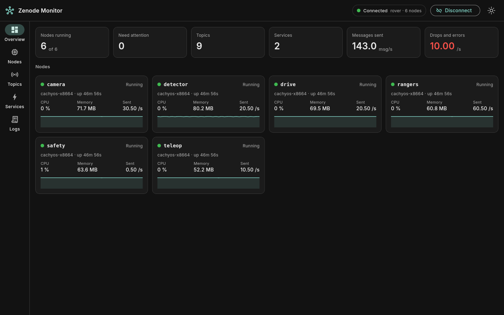
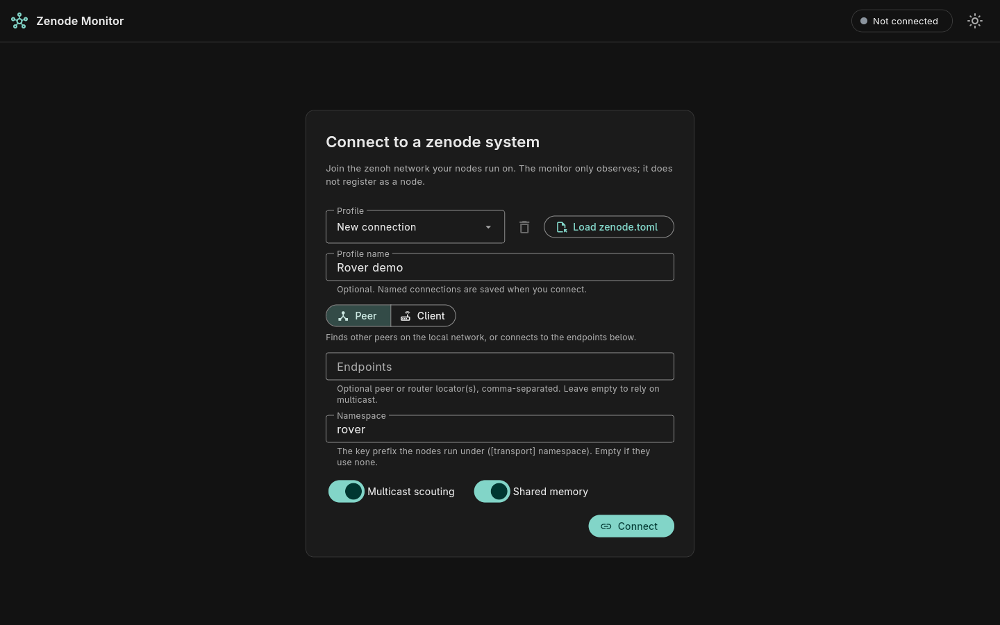
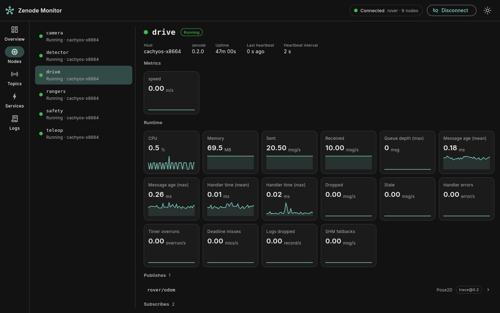
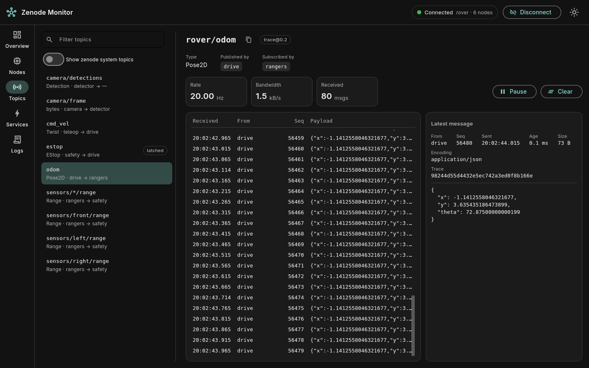
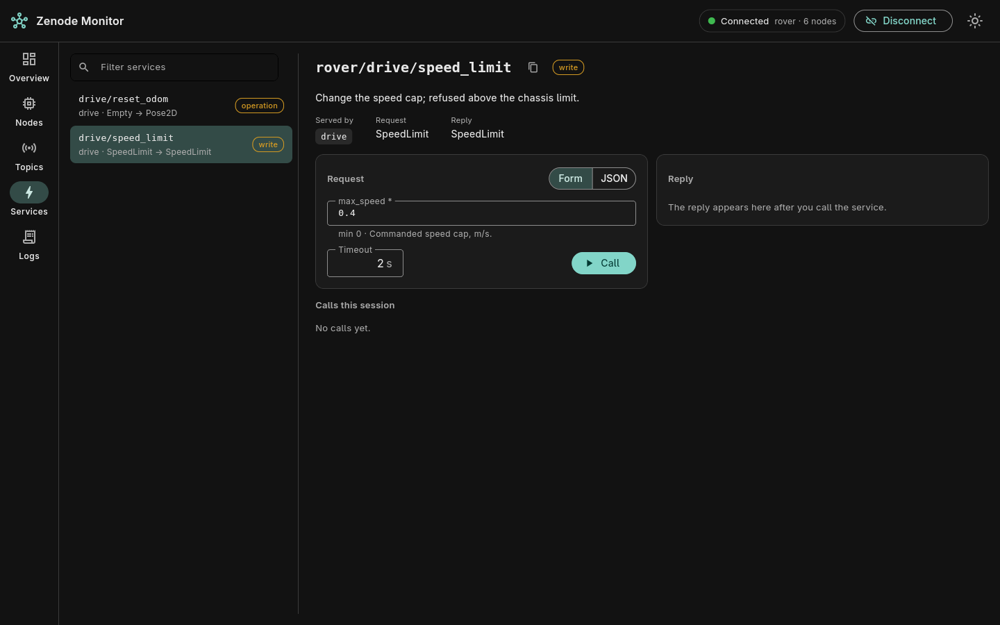

# Zenode Monitor

A desktop app for watching a [zenode](https://github.com/hse-deb-robodog/zenode) system on eclipse-zenoh, built with [Flet](https://github.com/flet-dev/flet).



## Run

```bash
uv sync
uv run zenode-monitor
```

`uv run flet run src/zenode_monitor/main.py` does the same with hot reload.

## Connecting

| Field | Meaning |
|---|---|
| Mode | `peer` finds nodes by multicast or connects to the endpoints you list. `client` connects to a zenoh router and needs an endpoint. |
| Endpoints | Zenoh locators, comma-separated, e.g. `tcp/192.168.1.10:7447`. A bare `host:port` is taken as TCP. |
| Namespace | The `[transport] namespace` the nodes run under. zenode cannot list namespaces, so this must match. |
| Shared memory | Turn on if the nodes publish topics over shared memory. |

"Load zenode.toml" fills the form from a config file's `[transport]` section. A connection with a profile name is saved to `~/.config/zenode-monitor/profiles.json`.

## Pages

- **Overview**: totals and one card per node.
- **Nodes**: state, host, uptime, runtime metrics and `@metric` values with history, published and subscribed topics, services, config (if the node sets `describe_config`), recent logs.
- **Topics**: who publishes and subscribes, plus the live messages of the selected topic with rate and bandwidth. Click a message to keep it open; Pause stops the list.
- **Services**: a request form generated from the service's JSON Schema (or raw JSON), the reply or error, and the calls made this session.
- **Logs**: all nodes' log records, filtered by level, node and text.

## Screenshots

| | |
|---|---|
| **Connect**  | **Node**  |
| **Topic**  | **Service**  |

## Releases

`.github/workflows/release.yml` builds a standalone binary with `flet pack` for Linux (x86_64 and arm64), Windows (x86_64) and macOS (Apple Silicon).

- Pushing a tag that matches the version in `pyproject.toml` (for example `v0.1.0`) builds all four and attaches them to a new GitHub release.
- "Run workflow" on the Actions page builds them without releasing; the archives are kept as workflow artifacts.

To build one locally for the platform you are on:

```bash
uv run --with pyinstaller flet pack src/zenode_monitor/main.py --name zenode-monitor \
  --pyinstaller-build-args=--copy-metadata=zenode
```

The binaries are not code-signed, so Windows and macOS warn on first start.

## Development

```bash
uv run pytest
```

| Path | Role |
|---|---|
| `src/zenode_monitor/bus.py` | zenoh session, subscriptions, service calls |
| `src/zenode_monitor/state.py` | model of the observed system, no UI code |
| `src/zenode_monitor/schema_form.py` | JSON Schema to form fields and back |
| `src/zenode_monitor/profiles.py` | saved connections |
| `src/zenode_monitor/ui/` | Flet pages and widgets |
